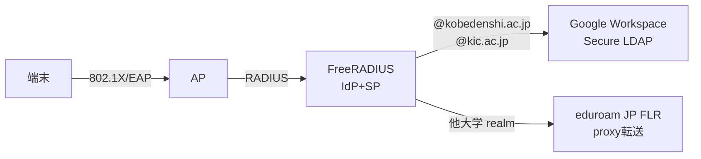
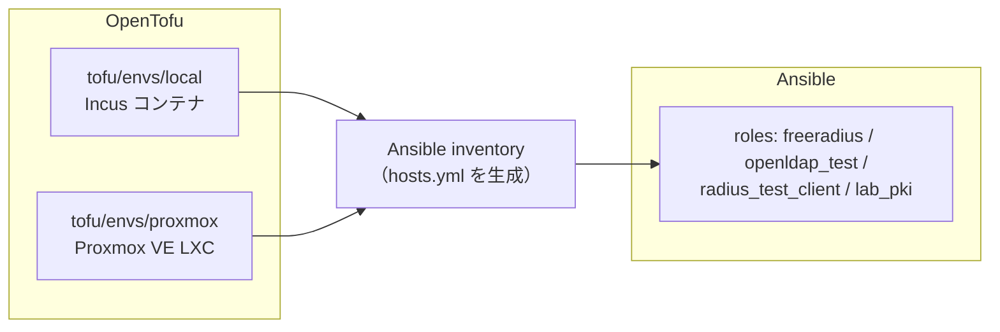

# eduroam技術検証環境

学校法人コンピュータ総合学園（神戸電子専門学校・神戸情報大学院大学）へのeduroam導入に向けた技術検証環境。
FreeRADIUS + Google Workspace Secure LDAPによるEAP-TTLS/PAP認証を、OpenTofu（ホスト作成）とAnsible（構成管理）で構築する。

## アーキテクチャ



## 認証方式

**EAP-TTLS/PAP** を採用。Google Workspace / Azure ADいずれもNTハッシュを提供できないため、PEAP/MSCHAPv2は使用不可。

## IaC の構成



- **OpenTofu**: Debian 13 のホスト（コンテナ）を作成し、Ansible の inventory を生成する。環境ごとに `tofu/envs/<環境>` を持つ
- **Ansible**: Debian パッケージの FreeRADIUS 3.2 を構成する。ロールは環境に依存せず、ローカル検証と Proxmox で同じものを使う

| 環境 | 基盤 | 用途 |
|------|------|------|
| `local` | WSL2 / Linux 上の Incus | Phase 1〜3 の検証（radius / ldap / client の3コンテナ） |
| `proxmox` | Proxmox VE の LXC | 実ネットワークでの検証・本番 |

## クイックスタート（local）

Linux または WSL2（systemd 有効）で実行する。

```bash
# 1. Incus の導入（初回のみ。incus-admin グループ追加後は再ログイン、WSL は wsl --terminate <distro>）
make incus-host

# 2. Ansible コレクション導入、vault.yml 作成、tofu init
make setup

# 3. コンテナ作成 + 構成
make up

# 4. 認証テスト
make test
```

設定を変更したら `make deploy` で反映する（変更があった場合のみ設定検証 `freeradius -C` を通してから再起動する）。

## 構成（local）

| コンテナ | Ansible グループ | 用途 | IPv4 |
|---------|-----------------|------|------|
| eduroam-radius | `radius` | FreeRADIUS（1812/udp, 1813/udp） | 10.180.0.10 |
| eduroam-ldap | `ldap_test` | 検証用 OpenLDAP（389） | 10.180.0.11 |
| eduroam-client | `test_client` | radtest / eapol_test | 10.180.0.12 |

## シークレットの管理

```bash
# make setup が vault.yml.example からコピーする
ansible/inventories/<環境>/group_vars/all/vault.yml
```

RADIUS 共有シークレット、LDAP パスワード、テストユーザーのパスワードは `vault.yml`（git 管理外）で管理する。共有・本番相当の環境では `ansible-vault encrypt` で暗号化する。
FreeRADIUS には systemd の EnvironmentFile（`/etc/freeradius/eduroam.env`、0600）経由で渡し、設定ファイルからは `$ENV{...}` で参照する。

検証用の CA・サーバ証明書はコントローラの `~/.local/share/eduroam/<環境>/pki/` に生成する（`EDUROAM_SECRETS_DIR` で変更可）。

## Makeコマンド

`ENV_NAME=proxmox` を付けると Proxmox 環境を操作する（既定は `local`）。

| コマンド | 説明 |
|---------|------|
| `make incus-host` | ホストに Incus を導入（local の初回のみ） |
| `make setup` | Ansible コレクション導入、vault.yml 作成、tofu init |
| `make plan` | tofu plan |
| `make infra` | tofu apply（ホスト作成と inventory 生成） |
| `make deploy` | Ansible で構成（設定変更の反映） |
| `make up` | `infra` + `deploy` |
| `make test` | 認証テスト |
| `make down` | tofu destroy |
| `make logs` | FreeRADIUS ログ表示（local） |
| `make radius-debug` | FreeRADIUS をデバッグモード（`-X`）で前面実行（local） |
| `make ldap-search` | 検証用 LDAP のエントリ表示（local） |
| `make lint` | リンター（yamllint / ansible-lint / ShellCheck / shfmt / tofu fmt・validate） |
| `make fmt` | フォーマッター（ansible-lint --fix / shfmt / tofu fmt） |
| `make clean-pki` | 検証用 PKI を削除 |

## リンター／フォーマッター

対象は IaC（Ansible / OpenTofu / シェルスクリプト）。Markdown のドキュメントは対象外。
各リンターは全ルール（オプトインを含む）を有効にし、警告もエラーとして扱う。

| 対象 | リンター | フォーマッター | 設定 |
|------|---------|---------------|------|
| YAML | yamllint | `ansible-lint --fix` | `.yamllint` |
| Ansible | ansible-lint（全ルール、`strict: true`） | `ansible-lint --fix` | `.ansible-lint` |
| シェルスクリプト | ShellCheck（`enable=all`）、shfmt | shfmt（`-s` 相当の簡略化を含む） | `.shellcheckrc` / `.editorconfig` |
| OpenTofu | `tofu fmt -check`、`tofu validate`（全環境） | `tofu fmt` | — |

`# noqa` などのインライン抑止は使わず、コードを直して解消する。ツールの制約で両立しないルールだけを設定ファイルで無効化している（yamllint の `comments-indentation` / `key-ordering`）。理由は各設定ファイルに記載している。

yamllint・ansible-lint・ShellCheck・shfmt は Makefile で版を固定し、`uvx` で実行する（[uv](https://docs.astral.sh/uv/) が必要）。ansible-lint は実行環境に合わせて ansible-core 2.16 を使い、コレクションは `make setup` で導入したものを参照する。

```bash
make fmt      # 書式を整える
make -k lint  # すべての検査を実行（-k で失敗しても残りを続ける）
```

GitHub Actions（`.github/workflows/lint.yml`）も、IaC 関連のファイルを変更した push で `make -k lint` を実行する。

WSL からだけコミットする場合は、git フックで `make lint` を実行できる。Windows の git からコミットするとフックがツールを見つけられず失敗するため、両方からコミットする環境では設定しない。

```bash
cat > .git/hooks/pre-commit <<'EOF'
#!/bin/sh
exec make lint
EOF
chmod +x .git/hooks/pre-commit
```

## 認証テスト

`make test` は test_client から次の4項目を確認する。

| # | 内容 | 期待結果 |
|---|------|---------|
| 1 | EAP なしの PAP（radtest） | Access-Reject |
| 2 | EAP-TTLS/PAP（eapol_test、サーバ証明書を CA で検証） | SUCCESS |
| 3 | EAP-TTLS/PAP 不正パスワード | EAP-Failure |
| 4 | 自機関以外の realm の内部 Identity | EAP-Failure |

## ドキュメント

- [アーキテクチャ設計書](docs/infrastructure/architecture.md) — システム全体像、認証フロー、フェーズ別構成
- [eduroam JP 申請資格調査](docs/application/eligibility.md) — 参加条件と申請ルートの整理
- [APベンダー調査](docs/ap/vendor-survey.md) — 6ベンダー比較、eduroam適性ランク、TCO試算

## 検証フェーズ

1. **Phase 1**: ローカル検証（OpenLDAP） ← 現在のフェーズ
2. **Phase 2**: Google Workspace Secure LDAP接続（`freeradius_ldap_backend: google`）
3. **Phase 3**: Proxy検証（モックFLR）
4. **Phase 4**: eduroam JP接続（NII登録後）
5. **Phase 5**: AP統合・実機テスト

## ディレクトリ構造

```
.
├── .github/workflows/
│   └── lint.yml             # make lint を実行する CI
├── tofu/envs/
│   ├── local/               # Incus（WSL2/Linux）
│   └── proxmox/             # Proxmox VE LXC
├── ansible/
│   ├── ansible.cfg
│   ├── requirements.yml
│   ├── playbooks/           # site.yml（構成）/ test.yml（認証テスト）
│   ├── inventories/         # 環境別の group_vars と vault.yml.example
│   └── roles/
│       ├── freeradius/      # FreeRADIUS 設定（テンプレート）
│       ├── openldap_test/   # 検証用 OpenLDAP とテストユーザー
│       ├── radius_test_client/
│       └── lab_pki/         # 検証用 CA・サーバ証明書
├── scripts/
│   └── incus-host-setup.sh  # Incus の導入
├── .ansible-lint            # ansible-lint 設定
├── .yamllint                # yamllint 設定
├── .shellcheckrc            # ShellCheck 設定
├── .editorconfig            # エディタ・shfmt 共通の書式
├── Makefile
└── README.md
```
